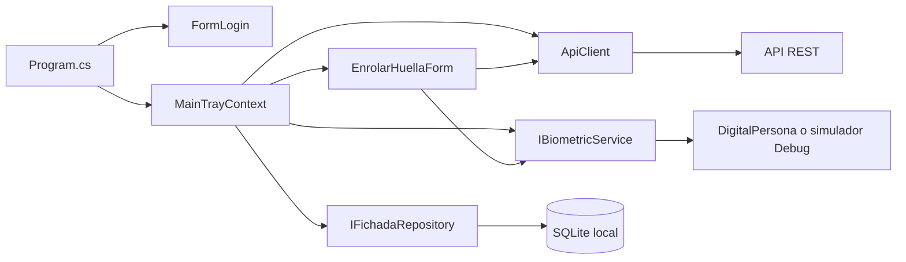

# Arquitectura y flujo de datos

## Vista general

La aplicación es un ejecutable WinForms para Windows, dirigido a .NET Framework 4.8. El código está organizado en capas por responsabilidad, pero no es una implementación estricta de Clean Architecture: la interfaz de bandeja coordina flujos y conoce servicios concretos.

### Responsabilidades

- **Presentación:** login, bandeja de Windows, estado del lector y formulario de enrolamiento.
- **Dominio:** modelos e interfaces para empleados, huellas, fichadas y servicios.
- **Infraestructura:** cliente HTTP, almacenamiento SQLite, repositorio, persistencia local, logs y adaptadores biométricos.

## Inicio de la aplicación

1. `Program` adquiere la instancia única del agente. Una segunda ejecución señala a la instancia activa y no inicia otro agente.
2. Se configura la URL de API y se intenta iniciar sesión con las credenciales guardadas.
3. Si no hay sesión válida, se muestra el formulario para vincular la terminal. Cancelar o fallar el inicio de sesión no impide que se abra la bandeja.
4. `MainTrayContext` inicializa SQLite, prepara el catálogo local y el servicio biométrico, y crea el icono del área de notificación.
5. El lector se inicia con reintentos si no está disponible. Los trabajos de red se ejecutan sin bloquear la captura ni la interfaz.

## Identificación y registro de una fichada

1. La huella capturada se compara con las plantillas compatibles del catálogo local.
2. Si se identifica al empleado, se comprueba la última fichada local. Una nueva marcación dentro de los cinco minutos posteriores se trata como duplicada.
3. El tipo local alterna entre `Entrada` y `Salida`; una nueva fecha inicia como `Entrada`.
4. La fichada se guarda primero en SQLite como pendiente y se inicia el envío en segundo plano.
5. Si la API confirma que recibió exactamente la cantidad de elementos del lote, se marcan como sincronizados. Si no, permanecen pendientes.

La petición de fichadas usa `POST /api/fichadas/biometricas/bulk` con elementos que contienen `empleadoId` y `fechaHora`. El tipo calculado localmente no forma parte del cuerpo enviado.

## Sincronización y API

| Propósito | Operación |
|---|---|
| Autenticación | `POST /api/auth/agente` |
| Heartbeat | `POST /api/agentes/{agenteId}/heartbeat`, cuerpo `{}` |
| Catálogo de empleados | `GET /api/empleados` |
| Huellas de la empresa | `GET /api/huellas/empresa/{empresaId}` |
| Envío de fichadas | `POST /api/fichadas/biometricas/bulk` |
| Enrolamiento | `POST /api/empleados/enrolar` |
| Obtención de sucursal al vincular | `GET /api/agentes/sucursal` |

Todas las llamadas del cliente tienen un timeout de 15 segundos. El catálogo local se reemplaza solo cuando las respuestas de empleados y huellas son válidas y el catálogo pasa sus validaciones; un fallo conserva el catálogo existente.

Los lotes de fichadas tienen hasta 500 elementos y se leen en orden de fecha y luego identificador. No se hace un POST cuando la cola está vacía. Si falla el envío, SQLite conserva las filas para otro intento.

## Intervalos y reintentos

Los intervalos normales están definidos en el código, no en archivos locales ni en una pantalla:

| Canal | Intervalo normal |
|---|---:|
| Heartbeat | 60 segundos |
| Catálogo de empleados y huellas | 20 minutos |
| Recuperación de fichadas pendientes | 60 segundos |
| Fichada recién registrada | Se intenta enviar al guardarla |

Cada canal mantiene su propia política de reintento temporal: 60, 120, 240 y hasta 300 segundos. El catálogo conserva su intervalo normal de 20 minutos. Se consideran temporales los errores de red, timeout, HTTP 429 y HTTP 5xx. El cliente puede renovar la sesión y repetir una vez una llamada rechazada con HTTP 401; si las credenciales son rechazadas, el operador debe vincular credenciales válidas.

## Persistencia

- La base de datos local contiene el catálogo, las plantillas y la cola de fichadas pendientes.
- Las credenciales y la configuración local del dispositivo se guardan bajo el perfil del usuario y se protegen con DPAPI para ese usuario de Windows.
- Los logs se escriben en el perfil local del usuario. La ruta y las recomendaciones de soporte se detallan en [[04-Configuration|Configuración]] y [[05-Operacion-y-soporte|Operación]].
